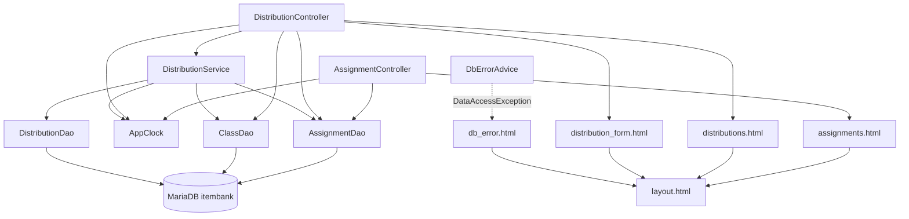

# 과제 배포(legacy/assignment-thymeleaf) 아키텍처

분석 기준일: 2026-09-29. 이 문서는 진입점과 의존 관계를 다룬다. 테이블 · 데이터 흐름은 [ERD.md](ERD.md), 비즈니스 규칙은 [BUSINESS-RULES.md](BUSINESS-RULES.md) 에 있다.
근거의 파일 경로는 저장소 루트 기준으로 적는다. 아래에서 `…/assign/` 은 `legacy/assignment-thymeleaf/src/main/java/com/example/assign/`, `…/templates/` 는 `legacy/assignment-thymeleaf/src/main/resources/templates/` 의 줄임이다.
소스를 읽어서 정리했다. 화면이나 DB 를 실행하지 않았다.

> **시각 고정**: `AppClock.now()` 는 시스템 속성 `app.clock=system` 이 없으면 항상 `2026-09-15 00:00:00` 을 돌려준다 (…/assign/AppClock.java:9, …/assign/AppClock.java:14-19). Dockerfile 의 ENTRYPOINT 는 이 속성을 주지 않는다 (legacy/assignment-thymeleaf/Dockerfile:11). 마감과 관련된 모든 동작은 이 고정 시각을 기준으로 한다.

## 1. 모듈 개요

- Spring Boot 3.3.4 · Java 17 · Thymeleaf · JdbcTemplate 으로 만든 과제 배포 화면 모듈이다 (legacy/assignment-thymeleaf/build.gradle:3, legacy/assignment-thymeleaf/build.gradle:11, legacy/assignment-thymeleaf/build.gradle:25-28).
- 내부 포트는 8080 이고 compose 가 호스트 8082 로 연결한다 (legacy/assignment-thymeleaf/src/main/resources/application.properties:1, docker-compose.yml:54).
- DB 는 MariaDB `itembank` 이고 커넥션 풀 최대 4, 대기 5초다 (legacy/assignment-thymeleaf/src/main/resources/application.properties:2, legacy/assignment-thymeleaf/src/main/resources/application.properties:6-7).
- 화면은 과제 목록 · 배포 목록 · 새 배포 세 개이고, 쓰기 동작은 새 배포와 재배포 둘이다 (…/templates/layout.html:24-26, …/assign/dao/DistributionDao.java:59-66).
- Java 소스 14개(테스트 제외) 가운데 `DistributionService.java` 가 701줄이고, 그중 `redistribute` 메서드 하나가 629줄(72~700)이다.
- 테스트는 `AppClockTest` 하나뿐이다 (legacy/assignment-thymeleaf/src/test/java/com/example/assign/AppClockTest.java:8). 서비스 · 컨트롤러 · DAO 테스트는 없다.

## 2. 폴더 구조

```
legacy/assignment-thymeleaf/
├── build.gradle · settings.gradle · Dockerfile
└── src/
    ├── main/java/com/example/assign/
    │   ├── AssignApplication.java        12줄   부트 진입점
    │   ├── AppClock.java                 28줄   현재 시각(고정) · 시각 포맷
    │   ├── web/
    │   │   ├── AssignmentController.java 35줄   / , /assignments
    │   │   ├── DistributionController.java 101줄 /distributions 계열
    │   │   └── DbErrorAdvice.java        18줄   DataAccessException → db_error 화면
    │   ├── service/
    │   │   └── DistributionService.java 701줄   배포 · 재배포
    │   ├── dao/
    │   │   ├── AssignmentDao.java        66줄
    │   │   ├── ClassDao.java             42줄
    │   │   └── DistributionDao.java     108줄   distribution · submission
    │   └── model/                         Row 5종 (getter/setter 만 있음)
    ├── main/resources/
    │   ├── application.properties
    │   └── templates/  layout · assignments · distributions · distribution_form · db_error
    └── test/java/com/example/assign/AppClockTest.java
```

## 3. 진입점

| URL (화면) | 컨트롤러 메서드 | 부르는 함수 | 결과 | 근거 |
|---|---|---|---|---|
| `GET /` | `AssignmentController.home` | 없음 | `/assignments` 로 리다이렉트 | …/assign/web/AssignmentController.java:21-23 |
| `GET /assignments` (과제 목록) | `AssignmentController.list` | `AssignmentDao.findAllForList`, `AppClock.now` | 뷰 `assignments` | …/assign/web/AssignmentController.java:26-33 |
| `GET /distributions` (배포 목록) | `DistributionController.list` | `DistributionService.listAll` → `DistributionDao.findAllForList`, `AppClock.now` | 뷰 `distributions` | …/assign/web/DistributionController.java:32-37, …/assign/service/DistributionService.java:38-39 |
| `GET /distributions/new` (새 배포 폼) | `DistributionController.form` | `AssignmentDao.findAllForSelect`, `ClassDao.findAll`, `AppClock.now` | 뷰 `distribution_form` | …/assign/web/DistributionController.java:40-46 |
| `POST /distributions` (배포 등록) | `DistributionController.create` | `AssignmentDao.findById`, `AppClock.now`, `AppClock.fmt`, `DistributionService.distribute` | 성공 `/distributions`, 실패 `/distributions/new` 로 리다이렉트 | …/assign/web/DistributionController.java:49-76 |
| `POST /distributions/{id}/redistribute` (재배포) | `DistributionController.redistribute` | `DistributionService.redistribute` | 항상 `/distributions` 로 리다이렉트 | …/assign/web/DistributionController.java:79-99 |

화면에서 이 URL 을 가리키는 곳:

| 위치 | 가리키는 URL | 근거 |
|---|---|---|
| 공통 메뉴 | `/assignments`, `/distributions`, `/distributions/new` | …/templates/layout.html:24-26 |
| 새 배포 폼 | `POST /distributions` (`assignmentId`, `classId`) | …/templates/distribution_form.html:8, …/templates/distribution_form.html:11, …/templates/distribution_form.html:23 |
| 배포 목록의 행별 폼 | `POST /distributions/{id}/redistribute` (`operator`, `reason`) | …/templates/distributions.html:31-35 |

## 4. 의존 관계

### 4.1 흐름도



### 4.2 주입 · 호출

| 호출하는 쪽 | 호출받는 쪽 | 근거 |
|---|---|---|
| `AssignmentController` | `AssignmentDao` (서비스 없이 DAO 직접) | …/assign/web/AssignmentController.java:17, …/assign/web/AssignmentController.java:28 |
| `DistributionController` | `DistributionService`, `AssignmentDao`, `ClassDao` | …/assign/web/DistributionController.java:26-29 |
| `DistributionService` | `DistributionDao`, `AssignmentDao`, `ClassDao` | …/assign/service/DistributionService.java:32-35 |
| `DistributionService.distribute` | `AssignmentDao.findById`, `ClassDao.findById`, `DistributionDao.countByAssignmentAndClass` · `nextId` · `insert`, `AppClock.now` | …/assign/service/DistributionService.java:48, …/assign/service/DistributionService.java:52, …/assign/service/DistributionService.java:59, …/assign/service/DistributionService.java:62-63 |
| `DistributionService.redistribute` | `DistributionDao.findById`(2회) · `findSubmissions` · `markRedistributed`, `AssignmentDao.findById`, `ClassDao.findById`, `AppClock.now` · `fmt` | …/assign/service/DistributionService.java:77, …/assign/service/DistributionService.java:153, …/assign/service/DistributionService.java:164, …/assign/service/DistributionService.java:239, …/assign/service/DistributionService.java:348, …/assign/service/DistributionService.java:620, …/assign/service/DistributionService.java:631 |
| 세 DAO | `JdbcTemplate` | …/assign/dao/AssignmentDao.java:17, …/assign/dao/ClassDao.java:16, …/assign/dao/DistributionDao.java:19 |

### 4.3 템플릿 포함

| 템플릿 | 포함하는 조각 | 근거 |
|---|---|---|
| `assignments.html` | `layout :: head`, `nav`, `flash`, `footer` | …/templates/assignments.html:3, …/templates/assignments.html:5, …/templates/assignments.html:7, …/templates/assignments.html:34 |
| `distributions.html` | 같음 | …/templates/distributions.html:3, …/templates/distributions.html:5, …/templates/distributions.html:7, …/templates/distributions.html:44 |
| `distribution_form.html` | 같음 | …/templates/distribution_form.html:3, …/templates/distribution_form.html:5, …/templates/distribution_form.html:7, …/templates/distribution_form.html:32 |
| `db_error.html` | `layout :: head`, `nav`, `footer` (`flash` 없음) | …/templates/db_error.html:3, …/templates/db_error.html:5, …/templates/db_error.html:9 |

### 4.4 눈에 띄는 점

- **규칙이 세 곳에 나뉘어 있다.** 새 배포의 마감 검사는 컨트롤러에 (…/assign/web/DistributionController.java:60-64), 삭제 과제 · 중복 검사는 서비스에 (…/assign/service/DistributionService.java:56-61), 선택 불가 표시는 템플릿에 있다 (…/templates/distribution_form.html:16).
- **오류 전달 방식이 두 가지다.** `distribute` 는 예외를 던지고 컨트롤러가 잡는다 (…/assign/service/DistributionService.java:50, …/assign/web/DistributionController.java:69). `redistribute` 는 예외 대신 `RedistributeResult` 의 `ok` · `code` 로 돌려준다 (…/assign/service/DistributionService.java:155-159).
- **`DbErrorAdvice` 는 조회 화면에서만 닿는다.** `create` · `redistribute` 는 `DataAccessException` 을 컨트롤러 안에서 먼저 잡는다 (…/assign/web/DistributionController.java:72, …/assign/web/DistributionController.java:87). `list` · `form` 과 `AssignmentController.list`, 그리고 `create` 의 서비스 호출 전 `assignmentDao.findById` (…/assign/web/DistributionController.java:53) 에서 난 예외만 어드바이스로 간다 (…/assign/web/DbErrorAdvice.java:11).
- **로그는 `System.out.println` 이다.** 재배포 감사 줄 `[REDIST] …` 과 DB 오류 줄 `[DB-ERROR] …` 이 표준 출력으로 나간다 (…/assign/service/DistributionService.java:693, …/assign/web/DbErrorAdvice.java:13).
- **`RedistributeResult` 의 일부 값은 화면에 쓰이지 않는다.** 컨트롤러는 `ok` · `message` · `warnings` 만 읽는다 (…/assign/web/DistributionController.java:91-97). `notes` · `summary` · `code` · `keptSubmissions` · `reopenTargets` 를 읽는 코드는 이 모듈에서 찾지 못했다(`code` 는 감사 로그에만 쓰인다, …/assign/service/DistributionService.java:692).
- **`DistributionService.get` 의 호출부를 찾지 못했다** (…/assign/service/DistributionService.java:42-44).
- **`redistribute` 는 `@Transactional` 안에서 제출 전체를 건수 제한 없이 순회한다** (…/assign/service/DistributionService.java:71, …/assign/service/DistributionService.java:375).

## 5. `redistribute` 내부 구간

| 구간 | 줄 | 하는 일 | DB 접근 |
|---|---|---|---|
| 0. 입력값 정리 | 81-150 | 작업자 · 사유 정규화, 사유 분류 | 없음 |
| 1. 배포 조회 | 152-161 | 없으면 E101 | 읽기 |
| 2. 과제 상태 | 163-236 | 상태 분기, E102 · E103 · E104, 제목 정리 | 읽기 |
| 3. 학급 | 238-262 | 학급 · 담당 교사 점검(경고만) | 읽기 |
| 4. 마감 판정 | 264-305 | 마감 구간(`dueBucket`) 계산 | 없음 |
| 5. 재배포 허용 판정 | 307-345 | E105 · E106 | 없음 |
| 6. 제출 현황 | 347-481 | 제출 행 집계 | 읽기 |
| 7. 제출 유지 정책 | 483-513 | 유지 · 재제출 대상 수 계산 | 없음 |
| 8. 통계 문구 | 515-586 | 제출률 · 평균 · 등급 분포 | 없음 |
| 9. 상태 전환 요약 | 588-617 | 안내 문구 | 없음 |
| 10. 플래그 갱신 | 619-639 | `redistributed = 1`, E107 | 쓰기 + 읽기 |
| 11. 결과 메시지 | 641-699 | 메시지 · 요약 · 결과 코드 · 감사 로그 | 없음 |

줄 번호는 모두 …/assign/service/DistributionService.java 기준이다.

## 6. 미확인 목록

| 항목 | 미확인 사유 |
|---|---|
| 실제 화면 출력 · 리다이렉트 동작 | 실행하지 않았다 |
| 운영 환경에서 `app.clock=system` 이 주어지는지 | 저장소의 Dockerfile · compose 에는 없다. 저장소 밖 실행 스크립트는 확인할 수 없다 |
| `DistributionService.get` 의 호출자 | 모듈 안에서 호출 줄을 찾지 못했다. 저장소 밖 호출 여부는 알 수 없다 |
| `notes` · `summary` 의 소비자 | 컨트롤러 · 템플릿에서 읽는 곳을 찾지 못했다 |
| `hiddenmethod.filter.enabled=true` 의 용도 | 설정은 있지만 (application.properties:13) `_method` 를 쓰는 폼을 찾지 못했다 |
| `characterization/` 의 과제 배포 테스트 | `tests/` 에는 `example-units.test.js`, `normalize.unit.test.js` 뿐이고 과제 배포 스냅샷은 없다 |
