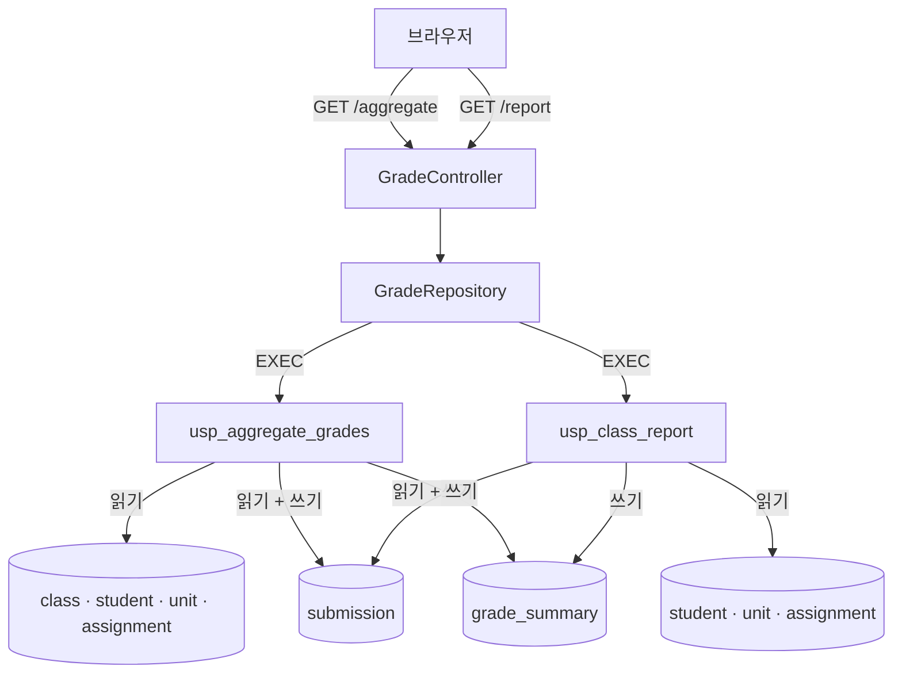

# 성적 집계(legacy/grade-mssql) 아키텍처

분석 기준일: 2026-09-29. 이 문서는 진입점과 의존 관계를 다룬다. 테이블 · 데이터 흐름은 [ERD.md](ERD.md), 비즈니스 규칙은 [BUSINESS-RULES.md](BUSINESS-RULES.md) 에 있다.
소스를 읽어서 정리했다. 화면이나 DB 를 실행하지 않았다.

근거의 파일 경로는 저장소 루트 기준으로 적는다. 아래 줄임을 쓴다.

| 줄임 | 가리키는 곳 |
|---|---|
| `AGG:` | `legacy/grade-mssql/sql/usp_aggregate_grades.sql` |
| `REP:` | `legacy/grade-mssql/sql/usp_class_report.sql` |
| `…/grade/` | `legacy/grade-mssql/src/main/java/com/example/grade/` |

> **전제 1 — 실행되는 프로시저는 사본이다.** DB 컨테이너는 `db/mssql/init/04-procs.sql` 을 실행한다 (db/mssql/entrypoint.sh:55). `legacy/grade-mssql/sql/` 의 두 파일은 읽기용 사본이다 (legacy/grade-mssql/sql/usp_aggregate_grades.sql:10-11). 분석 시점에 `CREATE` 부터 끝까지 본문이 같음을 `diff` 로 확인했다. `04-procs.sql` 의 줄번호는 집계 프로시저가 사본 + 5, 보고 프로시저가 사본 + 443 이다.
>
> **전제 2 — 현재 시각은 DB 서버 시각이다.** 두 프로시저 모두 `SYSDATETIME()` 을 쓴다 (legacy/grade-mssql/sql/usp_aggregate_grades.sql:30, legacy/grade-mssql/sql/usp_class_report.sql:30). 이 값은 기록 시각에만 쓰이고, 지연 판정은 제출 시각과 마감 시각만 비교한다. DB 컨테이너의 시간대는 `Asia/Seoul` 이다 (docker-compose.yml:78).
>
> **전제 3 — 접속 정보는 compose 가 아니라 Dockerfile 과 기본값에서 온다.** 앱은 `GRADES_JDBC_URL` · `GRADES_DB_USER` · `GRADES_DB_PASSWORD` 를 읽는다 (legacy/grade-mssql/src/main/resources/application.properties:5-7). compose 가 넘기는 `DB_HOST` · `DB_USER` 등은 (docker-compose.yml:86-90) 앱이 읽지 않는다. 주소는 Dockerfile 의 `ENV` 가 (legacy/grade-mssql/Dockerfile:11), 계정은 기본값 `app` 이 쓰인다.

## 1. 모듈 개요

- 비즈니스 규칙은 모두 MS-SQL 저장 프로시저 2개에 있고, Java 는 프로시저를 호출해 HTML 표로 보여 주기만 한다 (…/grade/GradeApplication.java:7-9).
- Spring Boot 3.3.5 · Java 21 · JdbcTemplate · mssql-jdbc 다 (legacy/grade-mssql/build.gradle.kts:3, legacy/grade-mssql/build.gradle.kts:12, legacy/grade-mssql/build.gradle.kts:21-23).
- 내부 포트 8080 을 compose 가 호스트 8083 으로 연결한다 (legacy/grade-mssql/src/main/resources/application.properties:2, docker-compose.yml:84).
- 커넥션 풀은 최대 3, 대기 5초다 (legacy/grade-mssql/src/main/resources/application.properties:12-13).
- 소스는 SQL 2개(437줄 · 198줄)와 Java 3개(17줄 · 144줄 · 54줄)다. 템플릿 파일은 없고 HTML 을 문자열로 만든다.
- 테스트 폴더(`src/test`)가 없다. `characterization/` 에도 이 모듈의 테스트 · 스냅샷이 없다.

## 2. 폴더 구조

```
legacy/grade-mssql/
├── Dockerfile · build.gradle.kts · settings.gradle.kts
├── sql/
│   ├── usp_aggregate_grades.sql   437줄   학급 성적 집계 (읽기용 사본)
│   └── usp_class_report.sql       198줄   학급 단원별 현황 (읽기용 사본)
└── src/main/
    ├── java/com/example/grade/
    │   ├── GradeApplication.java   17줄   부트 진입점
    │   ├── GradeController.java   144줄   URL 3개, HTML 조립
    │   └── GradeRepository.java    54줄   프로시저 호출, 값 포맷
    └── resources/application.properties

db/mssql/                          (모듈 밖, 읽기만 함)
├── Dockerfile · entrypoint.sh
└── init/  01-schema.sql · 02-seed.sql · 03-users.sql · 04-procs.sql
```

## 3. 진입점

| URL (화면) | 컨트롤러 메서드 | 부르는 함수 | 프로시저 | 근거 |
|---|---|---|---|---|
| `GET /` (안내) | `GradeController.index` | `head`, `foot` | 없음 | …/grade/GradeController.java:31-44 |
| `GET /aggregate?class_id=` (성적 집계) | `GradeController.aggregate` | `normalize` → `GradeRepository.aggregateGrades` → `table` | `dbo.usp_aggregate_grades` | …/grade/GradeController.java:46-56, …/grade/GradeRepository.java:24-25 |
| `GET /report?class_id=` (학급 단원별 현황) | `GradeController.report` | `normalize` → `GradeRepository.classReport` → `table` | `dbo.usp_class_report` | …/grade/GradeController.java:62-75, …/grade/GradeRepository.java:29-30 |

- 안내 화면의 링크 두 개가 위 URL 을 `class_id=C1` 로 가리킨다 (…/grade/GradeController.java:38-39).
- 두 화면 모두 `GET` 이지만 프로시저가 테이블을 갱신한다(`ERD.md` 3절).

## 4. 의존 관계

### 4.1 흐름도



### 4.2 함수 호출

| 호출하는 쪽 | 호출받는 쪽 | 근거 |
|---|---|---|
| `GradeController.aggregate` | `normalize`, `GradeRepository.aggregateGrades`, `head`, `esc`, `table`, `foot`, `error` | …/grade/GradeController.java:48-58 |
| `GradeController.report` | `normalize`, `GradeRepository.classReport`, `head`, `esc`, `table`, `foot`, `error` | …/grade/GradeController.java:64-77 |
| `GradeRepository.aggregateGrades` | `JdbcTemplate.query`, `rowToMap` | …/grade/GradeRepository.java:25 |
| `GradeRepository.classReport` | `JdbcTemplate.query`, `rowToMap` | …/grade/GradeRepository.java:30 |
| `rowToMap` | `format` | …/grade/GradeRepository.java:39 |

- 두 프로시저는 서로를 호출하지 않는다. `EXEC` 문이 프로시저 안에 없다.
- 프로시저를 부르는 SQL 은 고정 문자열이고 `class_id` 는 바인드 변수다 (…/grade/GradeRepository.java:25, …/grade/GradeRepository.java:30).

### 4.3 눈에 띄는 점

- **같은 규칙이 두 프로시저에 따로 구현돼 있다.** 무효 제외 · 최신 1건 · 지연 감점 · 미제출 처리가 각각 있다 (REP:13-18). 차이는 `BUSINESS-RULES.md` 5절에 모았다.
- **잠금 순서가 서로 반대다.** 집계는 `grade_summary` → `submission` (AGG:327, AGG:333, AGG:409), 보고는 `submission` → `grade_summary` (REP:158, REP:164, REP:172) 순으로 갱신한다. 저장소의 장애 로그에 두 프로시저가 서로를 막는 기록이 있다 (incident-logs/d-mssql-deadlock/mssql-wait.log:19-20).
- **가중치가 두 곳에 있다.** `unit.weight` 는 미제출 판정에, `CASE` 문의 값은 종합 점수 계산에 쓴다 (AGG:189, AGG:281-288).
- **집계는 커서를 다섯 개 쓴다.** 학생 × 단원 이중 커서, 종합 계산 이중 커서, 저장 검증 커서다 (AGG:150, AGG:160, AGG:255, AGG:269, AGG:373).
- **집계의 계산은 트랜잭션 밖, 저장만 트랜잭션 안이다** (AGG:330, AGG:415). 계산과 저장 사이에 제출이 바뀌면 계산 결과와 어긋날 수 있다(추정).
- **오류 화면이 DB 메시지를 그대로 보여 준다** (…/grade/GradeController.java:109-111). 상태 코드는 502 다 (…/grade/GradeController.java:113).
- **`DataAccessException` 만 잡는다.** 그 밖의 예외는 Spring 기본 오류 처리로 간다 (…/grade/GradeController.java:57, …/grade/GradeController.java:76).
- **읽기 전용 계정도 프로시저를 실행할 수 있고, 프로시저는 쓴다** (db/mssql/init/04-procs.sql:648-649, db/mssql/init/03-users.sql:30).
- **앱 계정 `app` 은 `db_owner` 다** (db/mssql/init/03-users.sql:24).
- **쓰이지 않는 변수**: `@student_count`, `@unit_count`, `@row_count` 는 값을 넣기만 하고 읽지 않는다 (AGG:102, AGG:111, AGG:393). `#unit.unit_name` 도 읽는 곳이 없다 (AGG:66).

## 5. 프로시저 내부 구간

### 5.1 `usp_aggregate_grades`

| 구간 | 줄 (AGG) | 하는 일 | 테이블 접근 |
|---|---|---|---|
| 0. 입력 확인 | 36-52 | 없는 학급이면 빈 결과 | `class` 읽기 |
| 1. 임시 테이블 | 54-91 | `#stu` · `#unit` · `#valid` · `#calc` 생성 | 없음 |
| 2. 대상 적재 | 93-132 | 학생, 단원 × 과제, 유효 제출 | `student` · `unit` · `assignment` · `submission` 읽기 |
| 3. 학생 × 단원 계산 | 134-230 | 미제출 · NULL 점수 · 지연 감점 | 없음 |
| 4. 단원별 등급 | 232-243 | 등급 부여 | 없음 |
| 5. 종합(TOTAL) | 245-324 | 가중 합, 등급 | 없음 |
| 6. 저장 | 326-415 | `grade_summary` 갱신 · 추가 · 삭제, 검증, `submission` 갱신 | 쓰기 |
| 7. 결과 | 417-435 | 결과 행 반환, 임시 테이블 삭제 | 없음 |

### 5.2 `usp_class_report`

| 구간 | 줄 (REP) | 하는 일 | 테이블 접근 |
|---|---|---|---|
| 0. 입력 확인 | 30-51 | 학생이 0명이면 빈 결과 | `student` 읽기 |
| 1. 유효 제출 | 53-93 | 최신 1건 + 지연 감점 점수 | `submission` · `student` · `assignment` 읽기 |
| 2. 단원별 집계 | 95-155 | 제출 · 미제출 · 지연 · 무효 수, 평균 · 최고 · 최저 | `unit` · `submission` · `student` 읽기 |
| 3. 보고 시각 기록 | 157-177 | `reported_at`, `last_report_at` | 쓰기 |
| 4. 결과 | 179-196 | 결과 행 반환 | 없음 |

## 6. 미확인 목록

| 항목 | 미확인 사유 |
|---|---|
| 실제 화면 출력, 프로시저 실행 결과 | 실행하지 않았다 |
| 운영 DB 의 프로시저가 저장소의 본문과 같은지 | 저장소 밖이다 |
| 프로시저를 부르는 다른 호출자(배치, SQL Agent 작업, 다른 시스템) | 저장소에는 Java 호출부만 있다. 저장소 밖은 볼 수 없다 |
| 두 프로시저가 동시에 돌 때 교착이 실제로 나는지 | 실행해야 알 수 있다. 장애 로그에는 잠금 대기 기록만 확인했다 |
| 장애 로그의 `line=172` · `line=409` 가 사본 기준 줄번호인지 | 값은 사본의 줄번호 (REP:172, AGG:409) 와 같지만 로그를 만든 기준을 알 수 없다 |
| 컨테이너에서 계정이 실제로 `app` 으로 접속되는지 | 환경 변수 이름으로 판단했다. 실행하지 않았다 |
