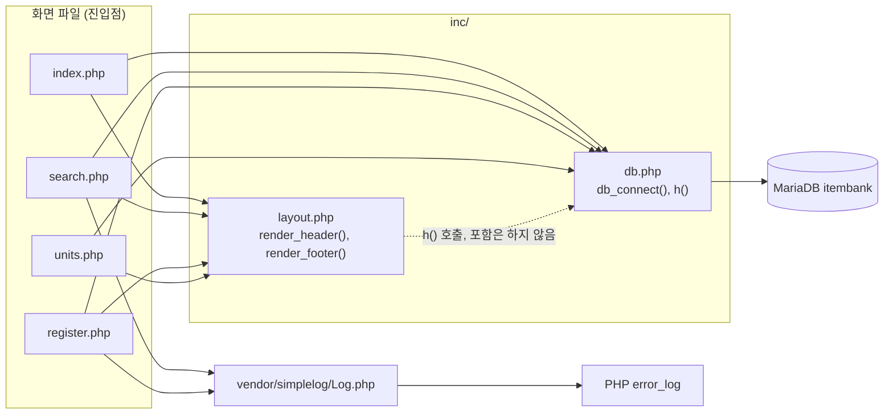

# 문항 은행(legacy/item-bank-php) 아키텍처

분석 기준일: 2026-09-29. 이 문서는 진입점과 의존 관계를 다룬다. 테이블 · 데이터 흐름은 [ERD.md](ERD.md) 에 있고, 비즈니스 규칙은 아직 정리하지 않았다.
근거의 파일 경로는 저장소 루트 기준으로 적는다. 줄번호 없이 쓴 파일 이름은 `legacy/item-bank-php/` 기준이다.

## 1. 모듈 개요

- PHP 7.4 · Apache · mysqli 로 만든 문항 은행 화면 모듈이다 (legacy/item-bank-php/Dockerfile:1, legacy/item-bank-php/Dockerfile:3).
- 소스 전체가 웹 루트 `/var/www/html/` 로 복사되고, 컨테이너 포트 80 이 호스트 8081 로 연결된다 (legacy/item-bank-php/Dockerfile:14, legacy/item-bank-php/Dockerfile:16, docker-compose.yml:39).
- 라우터 없이 PHP 파일 하나가 URL 하나다. 화면은 홈 · 문항 검색 · 문항 등록 · 단원 목록 네 개다 (legacy/item-bank-php/index.php:9-11, legacy/item-bank-php/inc/layout.php:30).
- vendor 를 제외하면 `Dockerfile` 포함 파일 7개, 1,066줄이고 그중 `search.php` 가 731줄이다.
- 모듈 폴더 안에는 문서와 테스트가 없다. 저장소의 `characterization/` 에 이 모듈을 참조하는 테스트 · 스냅샷이 있다(내용 미확인).

## 2. 폴더 구조

```
legacy/item-bank-php/
├── Dockerfile              16줄   실행 환경 (php:7.4-apache, mysqli)
├── index.php               14줄   홈 · 메뉴
├── search.php             731줄   문항 검색
├── register.php           177줄   문항 등록
├── units.php               48줄   단원 목록
├── inc/
│   ├── db.php              37줄   db_connect(), h()
│   └── layout.php          43줄   render_header(), render_footer()
└── vendor/
    └── simplelog/
        └── Log.php         54줄   외부 로깅 라이브러리(더미)
```

- `vendor/simplelog/Log.php` 는 수정하지 않는 외부 라이브러리다 (legacy/item-bank-php/vendor/simplelog/Log.php:3).
- 빌드 산출물 · 캐시 폴더는 없다.

## 3. 진입점

| URL (화면) | 처음 실행되는 파일 | 부르는 주요 함수 | 근거 |
|---|---|---|---|
| `/index.php` (홈 · 메뉴) | `index.php` | `render_header`, `render_footer` | legacy/item-bank-php/index.php:5, legacy/item-bank-php/index.php:14 |
| `/search.php` GET (문항 검색) | `search.php` | `render_header` → `db_connect` → `buildSearchQuery` → `renderSearchForm` → `runSearchQuery` → `renderResultTable` → `render_footer` | legacy/item-bank-php/search.php:709, legacy/item-bank-php/search.php:713, legacy/item-bank-php/search.php:722-725, legacy/item-bank-php/search.php:731 |
| `/register.php` GET (등록 폼) | `register.php` | `db_connect`, `render_header`, `h`, `render_footer` | legacy/item-bank-php/register.php:17, legacy/item-bank-php/register.php:127, legacy/item-bank-php/register.php:144, legacy/item-bank-php/register.php:177 |
| `/register.php` POST (등록 처리) | `register.php` | 위와 같음 + `Log::info` / `Log::error`. 검증 · 저장은 함수 없이 파일 최상위 코드 | legacy/item-bank-php/register.php:40, legacy/item-bank-php/register.php:85-123, legacy/item-bank-php/register.php:141 |
| `/units.php` (단원 목록) | `units.php` | `render_header`, `db_connect`, `h`, `render_footer` | legacy/item-bank-php/units.php:5, legacy/item-bank-php/units.php:8, legacy/item-bank-php/units.php:40, legacy/item-bank-php/units.php:48 |

- 화면 간 이동 링크: 홈 메뉴 (legacy/item-bank-php/index.php:9-11), 공통 내비게이션 (legacy/item-bank-php/inc/layout.php:10-12, legacy/item-bank-php/inc/layout.php:30).
- `search.php` 의 GET 파라미터는 `q`, `unit`, `level`, `tag`, `sort`, `dir`, `page` 다 (legacy/item-bank-php/search.php:5-12).
- `a2enmod rewrite` 는 켜져 있지만 (legacy/item-bank-php/Dockerfile:4) `.htaccess` 파일은 모듈 안에 없다.

## 4. 의존 관계

### 4.1 흐름도

화살표는 "A → B (A가 B를 포함하거나 호출)" 방향이다.
DB 접근은 `db.php → MariaDB` 화살표 하나로 줄여 그렸다. 실제 쿼리는 화면 파일이 `db_connect()` 로 받은 `$conn` 에 직접 실행한다 (legacy/item-bank-php/units.php:20, legacy/item-bank-php/register.php:27, legacy/item-bank-php/search.php:577).



### 4.2 파일 포함

| 방향 | 근거 |
|---|---|
| `index.php` → `inc/db.php` | legacy/item-bank-php/index.php:2 |
| `index.php` → `inc/layout.php` | legacy/item-bank-php/index.php:3 |
| `search.php` → `inc/db.php` | legacy/item-bank-php/search.php:20 |
| `search.php` → `inc/layout.php` | legacy/item-bank-php/search.php:21 |
| `search.php` → `vendor/simplelog/Log.php` | legacy/item-bank-php/search.php:22 |
| `register.php` → `inc/db.php` | legacy/item-bank-php/register.php:2 |
| `register.php` → `inc/layout.php` | legacy/item-bank-php/register.php:3 |
| `register.php` → `vendor/simplelog/Log.php` | legacy/item-bank-php/register.php:4 |
| `units.php` → `inc/db.php` | legacy/item-bank-php/units.php:2 |
| `units.php` → `inc/layout.php` | legacy/item-bank-php/units.php:3 |

### 4.3 함수 호출

| 방향 | 근거 |
|---|---|
| `inc/db.php` `db_connect` → MariaDB 연결 | legacy/item-bank-php/inc/db.php:21 |
| `inc/layout.php` `render_header` → `inc/db.php` `h` | legacy/item-bank-php/inc/layout.php:17, legacy/item-bank-php/inc/layout.php:33 |
| `search.php` `buildSearchQuery` → `inc/db.php` `h` | legacy/item-bank-php/search.php:360, legacy/item-bank-php/search.php:416, legacy/item-bank-php/search.php:494 외 |
| `search.php` `buildSearchQuery` → `Log::debug`, `Log::error` | legacy/item-bank-php/search.php:103, legacy/item-bank-php/search.php:528, legacy/item-bank-php/search.php:537 |
| `search.php` `buildSearchQuery` → DB (`unit`, `tag` 조회) | legacy/item-bank-php/search.php:125, legacy/item-bank-php/search.php:156, legacy/item-bank-php/search.php:178 |
| `search.php` `runSearchQuery` → DB (뷰 `v_item_public` 의 건수 · 목록 쿼리 실행) | legacy/item-bank-php/search.php:522, legacy/item-bank-php/search.php:577, legacy/item-bank-php/search.php:600 |
| `search.php` `renderResultTable` → `inc/db.php` `h` | legacy/item-bank-php/search.php:674-678 |
| `search.php` 최상위 → `Log::setThreshold`, `Log::error` | legacy/item-bank-php/search.php:27, legacy/item-bank-php/search.php:727 |
| `register.php` → DB (`unit`, `tag`, `item`, `item_tag`) | legacy/item-bank-php/register.php:27, legacy/item-bank-php/register.php:34, legacy/item-bank-php/register.php:87, legacy/item-bank-php/register.php:93, legacy/item-bank-php/register.php:105 |
| `register.php` → `Log::info`, `Log::error` | legacy/item-bank-php/register.php:115, legacy/item-bank-php/register.php:121 |
| `units.php` → DB (`unit`, `item`) | legacy/item-bank-php/units.php:16-20 |
| `Log::debug` / `info` / `warn` / `error` → `Log::write` → PHP `error_log` | legacy/item-bank-php/vendor/simplelog/Log.php:25, legacy/item-bank-php/vendor/simplelog/Log.php:30, legacy/item-bank-php/vendor/simplelog/Log.php:35, legacy/item-bank-php/vendor/simplelog/Log.php:40, legacy/item-bank-php/vendor/simplelog/Log.php:52 |

### 4.4 눈에 띄는 점

- `inc/layout.php` 는 `h()` 를 쓰지만 `inc/db.php` 를 직접 포함하지 않는다. 화면 파일이 `db.php` 를 먼저 포함해 주는 순서에 기대는 숨은 의존이다 (legacy/item-bank-php/inc/layout.php:17, legacy/item-bank-php/inc/db.php:34).
- HTML 이스케이프 함수 `h()` 가 DB 연결 파일 안에 있다 (legacy/item-bank-php/inc/db.php:34-37).
- `index.php` 는 `inc/db.php` 를 포함하지만 `db_connect()` 를 부르지 않는다 (legacy/item-bank-php/index.php:2, legacy/item-bank-php/index.php:5-14).
- `search.php` 는 로그 기준을 INFO 로 두므로 `Log::debug` 두 곳은 기록되지 않는다 (legacy/item-bank-php/search.php:27, legacy/item-bank-php/vendor/simplelog/Log.php:45).
- `runSearchQuery` 안에서 바인딩 코드가 두 번 반복된다 (legacy/item-bank-php/search.php:581-587, legacy/item-bank-php/search.php:604-610).
- `register.php` 는 목록 조회 결과가 `false` 인지 확인하지 않고 `fetch_assoc()` 를 부른다 (legacy/item-bank-php/register.php:27-28, legacy/item-bank-php/register.php:34-35).
- `register.php` 는 새 id 를 `MAX(id) + 1` 로 직접 채번한다 (legacy/item-bank-php/register.php:87).
- DB 접속 정보는 환경 변수로 받고, 없으면 코드에 든 기본값(실습용 더미 값)을 쓴다 (legacy/item-bank-php/inc/db.php:14-18).
- compose 의 `item-bank` 서비스는 `DB_HOST`, `DB_PORT`, `DB_NAME`, `DB_USER`, `DB_PASS` 를 넘기며 값은 위 기본값과 같다 (docker-compose.yml:40-45). 프로필은 `php` 이고 `mariadb` 가 healthy 가 된 뒤에 뜬다 (docker-compose.yml:37, docker-compose.yml:46-48).

## 5. 가장 긴 함수 3개

모듈 전체 함수는 vendor 포함 14개다.

| 순위 | 파일 | 함수 | 시작~끝 | 길이 | 하는 일 |
|---|---|---|---|---|---|
| 1 | `search.php` | `buildSearchQuery` | 42~564 | 523줄 | GET 파라미터로 SQL · 바인딩 값과 화면용 HTML(조건 요약 · 정렬 링크 · 폼 · 경고)까지 한꺼번에 만든다 (legacy/item-bank-php/search.php:29-41) |
| 2 | `search.php` | `renderResultTable` | 647~704 | 58줄 | 건수 · 결과 표 · 페이지 이동 링크를 출력하고, 0건이면 안내 문구만 출력한다 (legacy/item-bank-php/search.php:655-660, legacy/item-bank-php/search.php:683-703) |
| 3 | `search.php` | `runSearchQuery` | 571~624 | 54줄 | 건수 쿼리와 목록 쿼리를 prepared statement 로 실행해 `total` 과 `rows` 를 돌려준다 (legacy/item-bank-php/search.php:577, legacy/item-bank-php/search.php:600, legacy/item-bank-php/search.php:623) |

- 4위는 `render_header` 30줄이다 (legacy/item-bank-php/inc/layout.php:7-36).
- `buildSearchQuery` 하나가 `search.php` 731줄 중 약 72%, 모듈 전체의 약 절반이다.
- `register.php` 의 POST 처리 86줄은 함수가 아니라 최상위 코드여서 순위에서 빠졌지만, 길이로는 2위에 해당한다 (legacy/item-bank-php/register.php:40-125).

### 5.1 `buildSearchQuery` 내부 구간

함수 하나에 입력 처리 · DB 조회 · SQL 조립 · HTML 생성이 섞여 있다.

| 구간 | 줄 | 성격 |
|---|---|---|
| GET 파라미터 꺼내기 | legacy/item-bank-php/search.php:53-80 | 입력 |
| 키워드 조건 | legacy/item-bank-php/search.php:85-104 | 조건 조립 |
| 단원 조건 + 단원 이름 조회 | legacy/item-bank-php/search.php:109-147 | 조건 조립 · DB 조회 |
| 선택 목록 (단원 · 태그 · 난이도) | legacy/item-bank-php/search.php:152-206 | DB 조회 |
| 난이도 조건 | legacy/item-bank-php/search.php:211-230 | 조건 조립 |
| 태그 조건 | legacy/item-bank-php/search.php:235-261 | 조건 조립 |
| 정렬 | legacy/item-bank-php/search.php:266-331 | 조건 조립 |
| 페이지 | legacy/item-bank-php/search.php:336-349 | 조건 조립 |
| 조건 요약 HTML | legacy/item-bank-php/search.php:354-366 | 화면 |
| 링크용 쿼리 문자열 · 정렬 링크 · 페이지 링크 | legacy/item-bank-php/search.php:371-430 | 화면 |
| 검색 폼 데이터 · HTML | legacy/item-bank-php/search.php:435-504 | 화면 |
| 경고 HTML | legacy/item-bank-php/search.php:509-516 | 화면 |
| SQL 조립 | legacy/item-bank-php/search.php:521-526 | 조건 조립 |
| 바인딩 개수 검증 · 반환 | legacy/item-bank-php/search.php:528-563 | 검증 |

- 기본 정렬은 `level DESC, id ASC` 다 (legacy/item-bank-php/search.php:317-320).
- 페이지 크기는 20 이고 숫자로 세 곳에 들어 있다 (legacy/item-bank-php/search.php:349, legacy/item-bank-php/search.php:523, legacy/item-bank-php/search.php:553).
- 난이도를 비우면 주석은 "1~5 모두 포함"인데 조건은 `level < 5` 다 (legacy/item-bank-php/search.php:213-215). 의도된 규칙인지는 미확인이다.
- 사용자 입력은 모두 `?` 바인딩으로 들어가고, SQL 문자열에 직접 붙는 값은 정수로 변환한 `OFFSET` 뿐이다 (legacy/item-bank-php/search.php:98, legacy/item-bank-php/search.php:118, legacy/item-bank-php/search.php:218, legacy/item-bank-php/search.php:245, legacy/item-bank-php/search.php:523).

## 6. 미확인 목록

| 항목 | 미확인 사유 |
|---|---|
| 검색의 `level < 5` 조건이 의도된 규칙인지 | 코드 주석과 조건식이 서로 다르다 (legacy/item-bank-php/search.php:213-215) |
| `/` 접속 시 `index.php` 가 열리는지 (Apache `DirectoryIndex`) | 저장소 안에 Apache 설정 파일이 없어 코드로는 확인할 수 없다 |
| `characterization/` 테스트 · 스냅샷이 이 모듈의 무엇을 검증하는지 | 파일 이름 검색으로 참조 여부만 확인했고 내용은 읽지 않았다 |
| 비즈니스 규칙 후보 | 분석 전 단계 |

데이터 흐름 쪽 미확인 항목은 [ERD.md](ERD.md) 5절에 있다.
