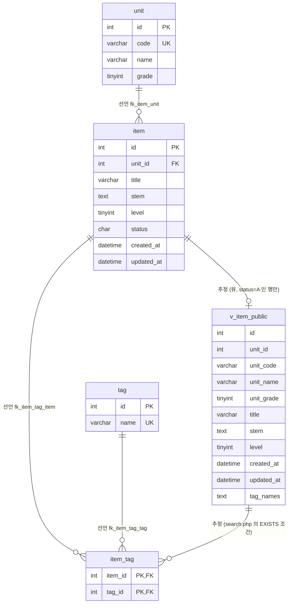

# 문항 은행(legacy/item-bank-php) 데이터 흐름 · ERD

분석 기준일: 2026-09-29. 선행 문서는 [ARCHITECTURE.md](ARCHITECTURE.md) 다.
근거의 파일 경로는 저장소 루트 기준으로 적는다. 줄번호 없이 쓴 PHP 파일 이름은 `legacy/item-bank-php/` 기준이다.
스키마 파일과 PHP 소스를 읽어서 정리했다. 실제로 DB 를 띄워 확인하지는 않았다.

## 1. 테이블 목록

스키마 정의는 `db/mariadb/init/01-schema.sql` 하나에 있고, compose 가 이 폴더를 MariaDB 초기화 폴더로 마운트한다 (docker-compose.yml:25).

### 1.1 이 모듈이 쓰는 테이블 · 뷰

| 이름 | 종류 | 주요 컬럼 | 근거 |
|---|---|---|---|
| `unit` | 테이블 | `id` INT PK, `code` VARCHAR(16) UNIQUE, `name` VARCHAR(100), `grade` TINYINT | db/mariadb/init/01-schema.sql:11-18 |
| `item` | 테이블 | `id` INT PK, `unit_id` INT FK, `title` VARCHAR(200), `stem` TEXT, `level` TINYINT(1~5), `status` CHAR(1) 기본 `'A'`(A=공개 D=삭제 R=검수중), `created_at` DATETIME, `updated_at` DATETIME | db/mariadb/init/01-schema.sql:20-33 |
| `tag` | 테이블 | `id` INT PK, `name` VARCHAR(50) UNIQUE | db/mariadb/init/01-schema.sql:35-40 |
| `item_tag` | 테이블 | `item_id` INT FK, `tag_id` INT FK, PK 는 (`item_id`, `tag_id`) | db/mariadb/init/01-schema.sql:42-48 |
| `v_item_public` | 뷰 | `id`, `unit_id`, `unit_code`, `unit_name`, `unit_grade`, `title`, `stem`, `level`, `created_at`, `updated_at`, `tag_names` | db/mariadb/init/01-schema.sql:52-70 |

- 네 테이블 모두 `id` 에 `AUTO_INCREMENT` 가 없다 (db/mariadb/init/01-schema.sql:12, db/mariadb/init/01-schema.sql:21, db/mariadb/init/01-schema.sql:36). 그래서 등록 화면이 id 를 직접 채번한다 (legacy/item-bank-php/register.php:87).
- `item` 의 인덱스는 `idx_item_unit (unit_id)`, `idx_item_level (level)` 두 개다 (db/mariadb/init/01-schema.sql:30-31). `status` 인덱스는 없다.
- `v_item_public` 은 `item` 과 `unit` 을 조인하고 `status = 'A'` 인 행만 남긴다 (db/mariadb/init/01-schema.sql:68-70). `tag_names` 는 태그 이름을 `tag.id` 순서로 쉼표로 이은 값이다 (db/mariadb/init/01-schema.sql:64-67).

### 1.2 같은 스키마에 있지만 이 모듈이 쓰지 않는 테이블

| 이름 | 근거 | 비고 |
|---|---|---|
| `class` | db/mariadb/init/01-schema.sql:75-80 | 과제 배포 모듈용 |
| `assignment` | db/mariadb/init/01-schema.sql:82-90 | `unit_id` 가 `unit(id)` 를 참조한다 (db/mariadb/init/01-schema.sql:89) |
| `distribution` | db/mariadb/init/01-schema.sql:92-103 | 과제 배포 모듈용 |
| `submission` | db/mariadb/init/01-schema.sql:105-115 | 과제 배포 모듈용 |

이 모듈의 PHP 파일에는 위 네 테이블을 가리키는 SQL 이 없다. 컬럼 상세는 이 문서의 범위 밖이다.

## 2. 테이블 관계

관계 이름 앞의 "선언"은 스키마에 외래 키로 선언된 관계, "추정"은 외래 키 없이 코드나 뷰 정의의 조인 조건에서 읽어 낸 관계다.

| 관계 | 구분 | 근거 |
|---|---|---|
| `item.unit_id` → `unit.id` | 선언 | db/mariadb/init/01-schema.sql:32 |
| `item_tag.item_id` → `item.id` | 선언 | db/mariadb/init/01-schema.sql:46 |
| `item_tag.tag_id` → `tag.id` | 선언 | db/mariadb/init/01-schema.sql:47 |
| `v_item_public.id` = `item.id` | 추정 | 뷰 정의 db/mariadb/init/01-schema.sql:54, db/mariadb/init/01-schema.sql:68 |
| `item_tag.item_id` = `v_item_public.id` | 추정 | legacy/item-bank-php/search.php:244-245 |

- 코드의 조인 조건 중 `i.unit_id = u.id` (legacy/item-bank-php/units.php:17) 와 `t.id = it.tag_id` (legacy/item-bank-php/search.php:244) 는 선언된 외래 키와 같은 관계다. 선언 없이 코드에만 있는 테이블 간 관계는 뷰를 거치는 위 두 건뿐이다.
- 뷰 컬럼의 타입은 원본 컬럼에서 옮겨 적었다. `tag_names` 의 실제 타입은 미확인이다(`GROUP_CONCAT` 결과).
- 외래 키에 `ON DELETE` · `ON UPDATE` 동작은 적혀 있지 않다 (db/mariadb/init/01-schema.sql:32, db/mariadb/init/01-schema.sql:46-47).

## 3. 읽기 · 쓰기 위치

함수 없이 파일 최상위에서 실행되는 코드는 "최상위"로 적는다. 이 모듈에 UPDATE · DELETE 문은 없다.

### 3.1 테이블별

| 테이블 | 읽기 (SELECT) | 쓰기 (INSERT · UPDATE · DELETE) |
|---|---|---|
| `unit` | `units.php` 최상위 — 단원 목록 (legacy/item-bank-php/units.php:16-20) `register.php` 최상위 — 선택 목록 (legacy/item-bank-php/register.php:27) `search.php` `buildSearchQuery` — 단원 이름 조회 (legacy/item-bank-php/search.php:125), 선택 목록 (legacy/item-bank-php/search.php:156) 뷰를 거친 간접 읽기 (아래 `v_item_public`) | 없음 |
| `item` | `units.php` 최상위 — 단원별 공개 문항 수 (legacy/item-bank-php/units.php:17) `register.php` 최상위 — 다음 id 채번, `FOR UPDATE` (legacy/item-bank-php/register.php:87) 뷰를 거친 간접 읽기 | INSERT: `register.php` 최상위 (legacy/item-bank-php/register.php:92-99) |
| `tag` | `register.php` 최상위 — 선택 목록 (legacy/item-bank-php/register.php:34) `search.php` `buildSearchQuery` — 선택 목록 (legacy/item-bank-php/search.php:178) `search.php` 태그 조건의 EXISTS 서브쿼리 (legacy/item-bank-php/search.php:244-245) 뷰를 거친 간접 읽기 | 없음 |
| `item_tag` | `search.php` 태그 조건의 EXISTS 서브쿼리 (legacy/item-bank-php/search.php:244-245) 뷰를 거친 간접 읽기 | INSERT: `register.php` 최상위 (legacy/item-bank-php/register.php:105-108) |
| `v_item_public` | `search.php` — SQL 조립은 `buildSearchQuery` (legacy/item-bank-php/search.php:521-526), 실행은 `runSearchQuery` (legacy/item-bank-php/search.php:577, legacy/item-bank-php/search.php:600) | 없음 |

- 태그 조건의 EXISTS 서브쿼리도 조립은 `buildSearchQuery`, 실행은 `runSearchQuery` 다.
- `register.php` 의 두 INSERT 는 한 트랜잭션 안에서 실행되고, 실패하면 롤백한다 (legacy/item-bank-php/register.php:85, legacy/item-bank-php/register.php:114, legacy/item-bank-php/register.php:120).

### 3.2 화면별 흐름

| 화면 | 입력 | 읽는 곳 | 쓰는 곳 | 출력 |
|---|---|---|---|---|
| 단원 목록 `units.php` | 없음 | `unit`, `item` (legacy/item-bank-php/units.php:16-19) | 없음 | 코드 · 단원명 · 학년 · 공개 문항 수 표 (legacy/item-bank-php/units.php:38-45) |
| 문항 등록 `register.php` | POST `title`, `stem`, `unit_id`, `level`, `tags[]` (legacy/item-bank-php/register.php:41-45) | `unit`, `tag`, `item` (legacy/item-bank-php/register.php:27, legacy/item-bank-php/register.php:34, legacy/item-bank-php/register.php:87) | `item`, `item_tag` (legacy/item-bank-php/register.php:92-99, legacy/item-bank-php/register.php:105-108) | 안내 · 오류 목록과 등록 폼 (legacy/item-bank-php/register.php:130-139, legacy/item-bank-php/register.php:141-175) |
| 문항 검색 `search.php` | GET `q`, `unit`, `level`, `tag`, `sort`, `dir`, `page` (legacy/item-bank-php/search.php:53-80) | `unit`, `tag`, `v_item_public`, `item_tag` (legacy/item-bank-php/search.php:125, legacy/item-bank-php/search.php:156, legacy/item-bank-php/search.php:178, legacy/item-bank-php/search.php:244, legacy/item-bank-php/search.php:522) | 없음 | id · 제목 · 단원 코드 · 난이도 · 태그 표 (legacy/item-bank-php/search.php:672-680) |
| 홈 `index.php` | 없음 | 없음 | 없음 | 메뉴 (legacy/item-bank-php/index.php:7-12) |

### 3.3 컬럼 사용

| 컬럼 | 쓰이는 곳 |
|---|---|
| `item.status` | 등록 시 `'R'` 로 저장 (legacy/item-bank-php/register.php:94). 단원 목록은 `'A'` 만 센다 (legacy/item-bank-php/units.php:17). 검색은 뷰가 `'A'` 만 남긴다 (db/mariadb/init/01-schema.sql:70) |
| `item.created_at`, `item.updated_at` | 등록 시 둘 다 DB 의 `NOW()` (legacy/item-bank-php/register.php:94). 검색은 `created_at` 만 조회 · 정렬에 쓴다 (legacy/item-bank-php/search.php:311, legacy/item-bank-php/search.php:521) |
| `item.title`, `item.stem` | 키워드 검색의 `LIKE` 대상 (legacy/item-bank-php/search.php:98). `stem` 은 검색 결과로 조회하지 않는다 (legacy/item-bank-php/search.php:521) |
| `item.level` | 검색 조건 (legacy/item-bank-php/search.php:215, legacy/item-bank-php/search.php:218, legacy/item-bank-php/search.php:226) 과 정렬 (legacy/item-bank-php/search.php:295-325) |
| `unit.code` | 검색 조건은 뷰의 `unit_code` 와 비교한다 (legacy/item-bank-php/search.php:118) |
| `tag.name` | 검색 조건 (legacy/item-bank-php/search.php:245). 뷰의 `tag_names` 로 화면에 나온다 (legacy/item-bank-php/search.php:678) |
| 뷰의 `unit_id`, `unit_name`, `unit_grade`, `stem`, `updated_at` | 검색의 SELECT 목록에 없다 (legacy/item-bank-php/search.php:521) |

## 4. 눈에 띄는 점

- 스키마 주석은 등록 화면도 뷰를 기준으로 삼는다고 적었지만 (db/mariadb/init/01-schema.sql:51), `register.php` 에는 `v_item_public` 을 쓰는 SQL 이 없다. 뷰를 쓰는 곳은 legacy/item-bank-php/search.php:522 뿐이다.
- 검색에서 난이도를 비우면 주석은 "1~5 모두 포함"이라고 하지만 조건은 `level < 5` 다 (legacy/item-bank-php/search.php:213-215). 시드 주석도 `status='A' AND level<5` 가 20건이라고 적고 있다 (db/mariadb/init/02-seed.sql:34). 의도된 규칙인지는 미확인이다.
- 페이지 크기 20 이 세 곳에 숫자로 들어 있다 (legacy/item-bank-php/search.php:349, legacy/item-bank-php/search.php:523, legacy/item-bank-php/search.php:553).
- 새 문항은 `'R'` 로 들어가는데 (legacy/item-bank-php/register.php:94), 이 모듈에는 `status` 를 바꾸는 SQL 이 없다.
- 단원 목록의 문항 수는 `item` 을 직접 세고 (legacy/item-bank-php/units.php:17), 검색은 뷰를 쓴다 (legacy/item-bank-php/search.php:522). 공개 조건 `status = 'A'` 가 두 군데에 따로 있다.

## 5. 미확인 목록

| 항목 | 미확인 사유 |
|---|---|
| 실제 DB 의 스키마가 `01-schema.sql` 과 같은지 | DB 를 띄워 확인하지 않았다 |
| `item.status` 를 `'R'` → `'A'`, `'A'` → `'D'` 로 바꾸는 주체 | 이 모듈에는 해당 SQL 이 없다. 다른 모듈은 읽지 않았다 |
| 다른 모듈(`legacy/assignment-thymeleaf`, `modern/api`)이 `unit` · `item` · `tag` · `item_tag` 를 읽고 쓰는 위치 | 분석 범위 밖이라 읽지 않았다 |
| `v_item_public.tag_names` 의 실제 컬럼 타입과 최대 길이 | `GROUP_CONCAT` 결과라 스키마 파일만으로는 알 수 없다 |
| 검색의 `level < 5` 조건이 의도된 규칙인지 | 코드 주석과 조건식이 서로 다르다 (legacy/item-bank-php/search.php:213-215) |
| 시드 데이터의 행 내용 | `02-seed.sql` 은 주석과 INSERT 대상 테이블만 확인했다 (db/mariadb/init/02-seed.sql:9, db/mariadb/init/02-seed.sql:19, db/mariadb/init/02-seed.sql:36, db/mariadb/init/02-seed.sql:76) |
